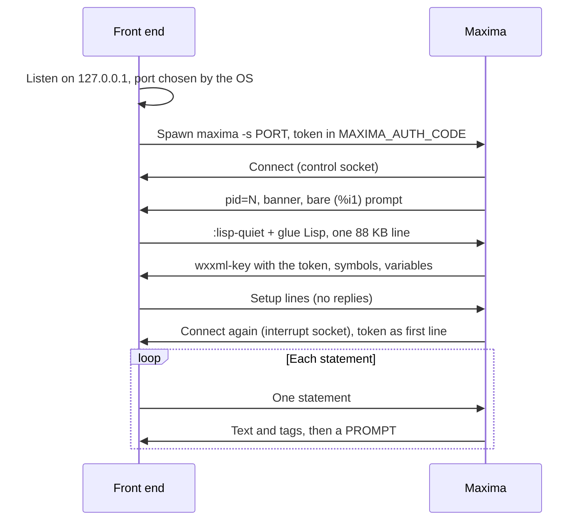

# The protocol nobody specified

How a graphical front end talks to Maxima, explained from the ground up. We found no specification for this protocol. What exists is a command-line flag, a Lisp file inside wxMaxima, and conventions that only show up when you run them.

The socket exchanges shown here were checked on macOS (arm64) against Homebrew Maxima 5.50.0 on SBCL 2.6.9, by an independent client, [`probe.py`](../Tests/Fixtures/transcripts/protocol/probe.py). Its results are saved in [`session.json`](../Tests/Fixtures/transcripts/protocol/session.json). The notes on process handling (signal masks, temporary files, shutdown) and on compiler notes come from MaximaKit's code and the phase reports. Other Maxima releases and other Lisps are untested. [`BOOTSTRAP.md`](BOOTSTRAP.md) keeps the terse reference and wxMaxima's source pointers; this document explains how the pieces fit and why they bite.

## Three layers, none of them a specification

| Layer | Where it lives | What it gives you |
| --- | --- | --- |
| Socket mode | Maxima's `-s <port>` flag (`server.lisp`) | Maxima's standard input and output, redirected to a TCP connection |
| Glue Lisp | `wxMathML.lisp`, shipped inside wxMaxima | Tagged XML output, authentication, the interrupt channel |
| Conventions | wxMaxima's C++ and observed behaviour | When to send, what a prompt means, how errors look |

The first layer knows nothing about graphical front ends: it is a remote terminal. Everything structured is added at runtime, by sending Lisp code down that terminal. Macsima uses `wxMathML.lisp` unmodified, and adds its own small `macsima.lisp` after it.

## The whole session at a glance



## 1. Maxima is the client

The direction surprises people. The front end opens the listening socket, and Maxima connects to it. The listener must therefore exist before the process starts.

1. Bind a TCP listener on `127.0.0.1` with port 0, and read the port the OS assigned.
2. Generate a random token and put it in the child's environment as `MAXIMA_AUTH_CODE`.
3. Spawn `maxima -s <port>` in its own process group.
4. Accept the first connection. It is the control socket.

Any local process can connect to a loopback port, so the first connection is not trusted until it proves it knows the token. Macsima closes any further connection until then.

## 2. Bootstrapping: teaching Maxima to speak XML

Before the glue arrives, the stream is what a terminal would show:

```text
pid=3065
Loading ~/.maxima/maxima-init.mac
Maxima 5.50.0 https://maxima.sourceforge.io
using Lisp SBCL 2.6.9
...
(%i1) 
```

That first `(%i1) ` is not wrapped in any tag, because prompt tags do not exist yet. The front end sends the glue as a single line:

```text
:lisp-quiet <the whole Lisp file, comments and indentation removed, lines joined>
```

`:lisp-quiet` is a Maxima command that evaluates Lisp without printing a prompt. The line is 87,652 bytes for `wxMathML.lisp`. Removing comments has to respect strings, because a `;` inside a Lisp string is not a comment (`GlueLisp.command`).

Maxima answers with about 75 KB: compiler notes, the symbol list for autocompletion and the values of GUI variables.

### Authentication

The glue's first act is to print the token back. In 5.50.0 it arrives **nested inside** `<suppressOutput>`, among the compiler notes:

```xml
<suppressOutput>
<wxxml-key>PROTOCOL-DOC-TOKEN</wxxml-key>
; in:
;      PROGN (FORMAT T ...
```

Until the echoed token matches, the session ignores everything else. A mismatch ends the session.

### Setup lines

After authentication the front end sends these lines without waiting, because **none of them gets a prompt back**:

| Line | Purpose |
| --- | --- |
| `(setf $gnuplot_command "...")` | GUI apps do not inherit the shell's `PATH` |
| `(setf $maxima_tempdir "...")` | Plot files go to a private folder (Macsima's addition) |
| `(wx-open-interrupt-channel "127.0.0.1" PORT "TOKEN")` | Asks Maxima to open the second socket |
| `(setf (symbol-value '*lisp-quiet-suppressed-prompt*) "<PROMPT>(%i1)</PROMPT>")` | Seeds the prompt that `:lisp` restores |
| `(setf *prompt-suffix* "</PROMPT>") (setf *prompt-prefix* "<PROMPT>") ...` | From here on, prompts are tagged |

Each is sent as a `:lisp-quiet` line. Macsima then sends `macsima.lisp` the same way.

## 3. The stream: text with tags mixed in

The output is **not** an XML document. It has no root element, and plain text sits between the elements:

```text
expt: undefined: 0 to a negative exponent.
 -- an error. To debug this try: debugmode(true);
<PROMPT>(%i5) </PROMPT>
```

So a standard XML parser cannot read it. `TagScanner` works on bytes instead:

- A top-level element starts only at an exact `<name>` for a known name. Top-level tags never carry attributes, while tags inside math do, so the two cannot be confused.
- An element's content runs to the first matching `</name>`.
- Anything else is plain text, reported line by line.
- Results must not depend on how TCP split the data. A tag or a UTF-8 character can be cut anywhere, so incomplete input is held until more arrives.

| Top-level tag | Carries |
| --- | --- |
| `PROMPT` | The prompt, and the signal that Maxima is waiting |
| `math` | One piece of output: an optional label plus 2D math |
| `suppressOutput` | Output to hide, such as compiler notes |
| `variables` | Values of GUI-relevant variables |
| `wxxml-symbols` | Names and templates for autocompletion |
| `statusbar` | Text from `wxstatusbar()` |
| `wxasync` | Background output, routed by cell ID |
| `macsima-help`, `macsima-values`, `macsima-variable-names` | Replies from Macsima's own Lisp |

What arrives as what is not obvious, so do not guess:

| Output | Form |
| --- | --- |
| A result | `<math><lbl altCopy="%o1">(%o1) </lbl>...</math>` |
| `print("hello")$` | `<math><st>hello</st><st> </st></math>` |
| A plot | `<math>` with an `` naming a temporary file |
| Errors | Plain text |
| `tex()` output | Plain text |
| Anything under `display2d:false` | Plain text |

## 4. Prompts are the only clock

There are no request IDs, no acknowledgements and no end-of-reply marker. The **only** way to know a statement has finished is the next prompt, so a front end sends one statement and waits for it.

The content of the prompt decides what happens next:

| Content | Meaning | Next step |
| --- | --- | --- |
| `(%i6) ` | Main prompt | Send the next statement |
| `\nMAXIMA> ` | Lisp REPL, after `to_lisp()` | Switch to Lisp mode |
| `\n(dbm:1) ` | Maxima debugger | Show debugger controls |
| Anything else, usually `<math>...</math>` | A question for the user | Stop the queue and ask |

A question looks like this, and nothing else marks it as one:

```xml
<PROMPT><math><st>Is </st><mi lisp="*var-tag*">y</mi><st> positive, negative or zero?</st></math></PROMPT>
```

The input label is not a reliable counter either. A syntax error and a `:lisp` line both leave it unchanged: in the capture, `1/0;` is followed by `(%i5)`, and so are the syntax error and the `:lisp` line after it.

## 5. Errors are strings

Maxima reports no error status. A front end recognizes failures by matching text in the output of the statement (`OutputClassifier`):

| Text | Meaning |
| --- | --- |
| A line containing `-- an error.` | A Maxima error; the message is on the lines before it |
| A line starting `incorrect syntax:` | A syntax error, followed by an echo and a caret |
| `Maxima encountered a Lisp error:` up to `Automatically continuing.` | A Lisp error |
| The same block holding `User interrupt` | An interrupt through the channel, not a failure |
| The same block holding `Interactive interrupt at #x...` | An interrupt through SIGINT, not a failure |

These strings are effectively the API, which makes them the most fragile part of the protocol. Pin the Maxima version and test against recorded sessions.

## 6. Interrupting a computation

While Maxima computes it does not read the control socket, so an interrupt needs another path. There are two:

| Path | How it works | Result in the stream |
| --- | --- | --- |
| Interrupt channel (preferred) | Maxima connects a second time and sends the token as its first line. The front end later writes `interrupt\n` on that socket | ` User interrupt` |
| SIGINT (fallback) | Signal the process group | ` Interactive interrupt at #x...` |

The channel needs a Lisp with threads, because a thread waits on the socket. Maxima reports whether it is available in `*wx-interrupt-channel-available*`. Both paths end with a normal main prompt, and the session carries on.

## 7. The traps

Each of these showed up while building Macsima.

### A `:lisp-quiet` line never gets a prompt

A front end that waits for a prompt after every line hangs here. Macsima sends `:lisp-quiet (setq $linel N)` before every statement, so it must never wait for these lines. If the *user* types one in a cell, the session ends that statement immediately.

### Break commands go silent after `:lisp-quiet`

This is the best example of why the protocol has to be run to be understood. `:lisp-quiet` blanks Maxima's prompt variable (`*mread-prompt*` in `mdebug.lisp`). A normal statement restores it, but a break command such as `:break` or `:info` just prints whatever is there:

| Sent | Prompts received |
| --- | --- |
| `:info :bkpt` right after a statement | 1 |
| `:lisp-quiet (...)`, then `:info :bkpt` | **0: the cell hangs** |

The fix makes the outcome independent of what ran before. Blank the prompt on purpose, run the command, then restore it with `:lisp`, which prints exactly one prompt:

```text
:lisp-quiet nil
:info :bkpt
:lisp (values)
```

### While a question waits, every line is the answer

Background queries are `:lisp-quiet` lines too. Sent during a question, one is parsed as the answer, and the question is lost:

```text
sent:     asksign(y);
received: <PROMPT><math>...positive, negative or zero?</math></PROMPT>
sent:     :lisp-quiet (setq $linel 80)
received: incorrect syntax: : is not a prefix operator
          :l
           ^
          <PROMPT>(%i8) </PROMPT>
```

Macsima holds background queries until the session is idle.

### Compiler notes can look like replies

SBCL's notes quote the source they compile, tag names included. A note about `macsima.lisp` was once read as a real `<macsima-help>` reply. The file's definitions now sit inside `<suppressOutput>`, as the glue's do. It spells that tag with `code-char`, so a note quoting the source cannot contain the closing tag and end the block early.

### The child inherits your signal mask

`posix_spawn` passes blocked and ignored signals to the child. Under the test runner, Maxima started with SIGTERM blocked and ignored the kill sequence. `MaximaProcess` resets the mask and the signal handlers when spawning.

### Temporary files outlive their names

gnuplot scripts get random names, so deleting `maxout*` by pattern leaves files behind, and could touch another Maxima's files. Each session gets a private folder through `TMPDIR` and `$maxima_tempdir`, which a kill deletes. Plot images disappear with it, so the worksheet reads each image as soon as its `` arrives.

## 8. Shutting down

Closing the socket is not enough, because a Maxima busy computing only notices when it next reads.

1. Close the sockets and the listener.
2. Send SIGTERM to the process group, which also holds any running gnuplot.
3. After a grace period of 2 seconds, send SIGKILL.
4. Delete the session's temporary folder.

`OrphanGuard` does the same from signal handlers when the host itself is told to quit.

## Where each part lives

| Concern | Code |
| --- | --- |
| Listener, spawn, sockets, kill | `Sources/MaximaKit/Engine/ProcessTransport.swift`, `MaximaProcess.swift` |
| Glue framing and setup lines | `Sources/MaximaKit/Engine/GlueLisp.swift` |
| Splitting the stream | `Sources/MaximaKit/Protocol/TagScanner.swift` |
| Classifying prompts | `Sources/MaximaKit/Protocol/PromptClassifier.swift` |
| Recognizing errors | `Sources/MaximaKit/Session/OutputClassifier.swift` |
| Queue and state machine | `Sources/MaximaKit/Session/MaximaSession.swift` |

## Checking it yourself

The probe starts its own Maxima, runs every scenario above and prints what it found. It needs only Python 3 and Homebrew's Maxima:

```bash
python3 -I Tests/Fixtures/transcripts/protocol/probe.py Tests/Fixtures/transcripts/protocol/session.json
```

Run it again after any Maxima upgrade, and compare the result with the saved `session.json`. Machine-specific values, such as plot file names and memory addresses, are expected to differ.
